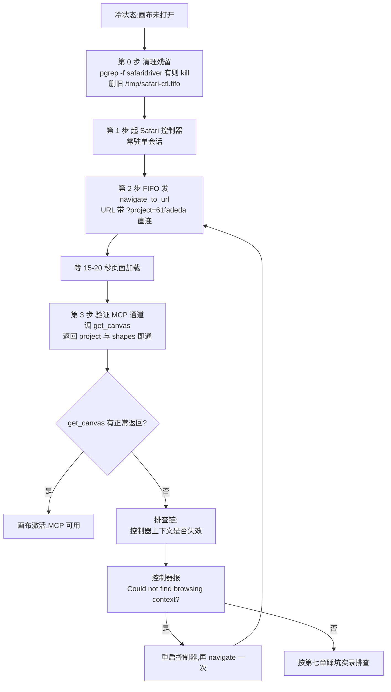
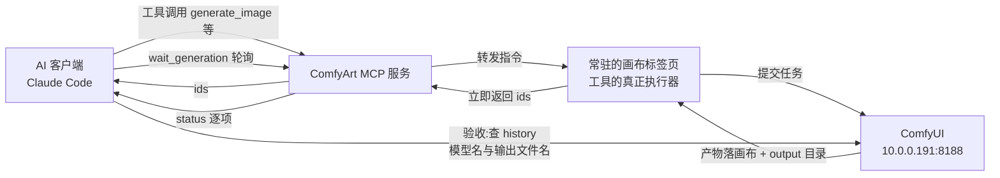
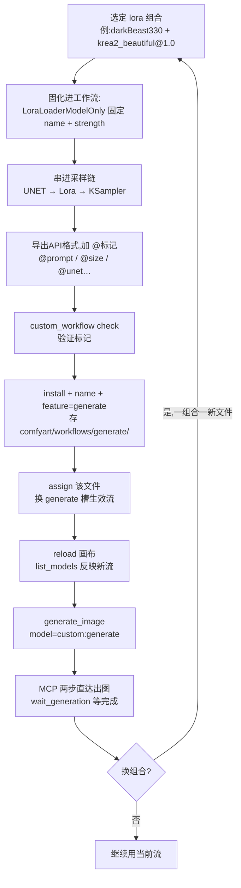

# ComfyArt 图片生成实战白皮书

> 读者:想让 AI(MCP)全自动操作 ComfyUI 生图的 homelab 玩家/开发者。
> 验收标准:零上下文的新会话只读本白皮书,从画布未激活的冷状态开始,把全部图片功能逐一跑通,遇到问题能自行按白皮书排查或提 issue。
> 本白皮书所有命令与参数均出自 2026-10-28 实测素材,未实测的功能全部明确标注"未实测"。

---

## 一、这是什么:ComfyArt + MCP 的定位

**ComfyArt** 是跑在 ComfyUI 上的一个设计画布项目(网页应用):打开一个项目页面,画布上可以放图、文字、形状,生成结果直接落在画布上,同时落到 ComfyUI 的 output 目录。本白皮书涉及的实例环境为:Mac + Safari 客户端;ComfyUI 跑在内网机器 170hx(`10.0.0.191:8188`);ComfyArt 项目 id 为 `61fadeda`。

**MCP**(Model Context Protocol,大白话:给 AI 装的"手")是一种让 AI 客户端(如 Claude Code)直接调用外部工具的标准协议。ComfyArt 提供了一整套 MCP 工具——`generate_image`、`edit_image`、`list_models` 等——AI 通过这些工具就能直接生图、改图、管理模型,**全程不需要人去点界面**。这就是"AI 全通道操作 ComfyUI"的含义:从写提示词、挂参考图、发起生成、等待结果到验收产物,每一步都是 AI 的 MCP 调用。

但有一条边界必须先立好,后面第三章整章在讲它:

- **浏览器只负责一件事——激活画布**:把 ComfyArt 项目页面打开并保持常驻。画布工具由这个开着的浏览器标签页执行,页面一关,所有 MCP 画布工具立即超时(报 "the ComfyArt page did not finish")。
- **其余一切(提示词/参考图/生成/等待/验收)全走 MCP**。

### 术语速查(首现大白话,后文直接用)

| 术语 | 大白话解释 |
|---|---|
| 画布激活 | 把 ComfyArt 项目页在浏览器里打开并保持常驻;激活了 MCP 画布工具才能用 |
| shape id | 画布上每个元素的身份证号;改图类工具靠它指认"改哪张图" |
| 槽 | 功能位,如 generate/style/edit/angles;每个槽有一个当前生效的流,可切换 |
| 自定义流 | 你自己导出并 install 的 API 格式工作流,顶替某个槽的默认逻辑 |
| 内置模型 | ComfyArt 自带的图片模型,完整 id:qwen-image-2.1-t2i.api.json / z-image-turbo-t2i.api.json / ideogram4-t2i.api.json(调用时逐字全传,禁止简写) | <!-- issue#5 --> |
| lora | 挂在底模上的小型微调文件,像"风格插件",不换底模也能改变画风 |
| assign | 把某个已 install 的工作流设为某槽当前生效的操作 |
| API 格式工作流 | ComfyUI"工作流→导出API"得到的 JSON,自定义流的原材料 |
| history | ComfyUI 的生成历史;验收产物看这里的模型名与输出文件名 |
| output 目录 | ComfyUI 落盘产物目录;画布上的图同时会存一份到这里 |

为什么画布必须常驻?因为 ComfyArt 的画布工具不是服务器后台跑的,而是由那个开着的浏览器标签页来执行的——标签页就是执行器。这是整套体系的物理基础,记住这一点,后面一半的坑都能自己解释。

---

## 二、冷启动:激活画布

冷启动指从"画布关闭的冷状态"到"MCP 可用"的完整路径,一共四步:第 0 步清理残留,第 1 步起控制器,第 2 步 navigate 直连,第 3 步用 MCP 的 get_canvas 验证通道。 <!-- issue#7 -->

这张图讲什么:从零开始,先清理残留进程与旧管道,再起浏览器控制器、直连画布、用 get_canvas 验证 MCP 通道,直到画布激活、MCP 可用的完整冷启动路径。 <!-- issue#7 -->



节点大白话注释:
- **冷状态:画布未打开**——浏览器里没有 ComfyArt 项目页,此时任何 MCP 画布工具都会超时。
- **第 0 步 清理残留**——上次跑剩下的 safaridriver 进程与旧 `/tmp/safari-ctl.fifo` 不清,新控制器会把指令发进死管道;`pgrep -f safaridriver` 有输出就 kill,再删掉旧 FIFO。 <!-- issue#7 -->
- **第 1 步 起 Safari 控制器**——一个常驻的浏览器控制服务,单会话,所有后续浏览器指令都通过它发。脚本在本仓库 `工具/safari-controller.py`。
- **第 2 步 FIFO 发 navigate_to_url**——往控制器的命名管道写一条 JSON 指令,让 Safari 打开画布 URL。**URL 必须带 `?project=<id>` 参数直连**,不要走列表页点击。
- **等 15-20 秒**——页面加载需要时间,别急着发下一条指令。
- **第 3 步 验证 MCP 通道(get_canvas)**——在 Claude Code 里调 comfyart 的 `get_canvas`,**返回里带 project 与 shapes 即通**;不要依赖 `evaluate_javascript`,它在部分环境恒返回 null。 <!-- issue#3 -->
- **排查链**——验证失败时先怀疑控制器上下文失效(页面 reload 过),重启控制器再 navigate;还不行再查踩坑实录。

四步的具体命令(实测原文):

```bash
# 第 0 步 清理残留:旧 safaridriver 进程与旧 FIFO,不清则后续指令发进死管道 <!-- issue#7 -->
pgrep -f safaridriver && kill $(pgrep -f safaridriver)   # pgrep 有输出才 kill <!-- issue#7 -->
rm -f /tmp/safari-ctl.fifo                               # 删旧命名管道 <!-- issue#7 -->

# 第 1 步 起 Safari 控制器(常驻单会话;脚本见本仓库 工具/safari-controller.py) <!-- issue#7 -->
nohup python3 ~/Documents/tmp/safari-controller.py > ~/Documents/tmp/safari-controller.log 2>&1 &

# 第 2 步 一条命令直达画布(带 ?project= 参数直连,不要走列表页点击!) <!-- issue#7 -->
echo '{"id":1,"name":"navigate_to_url","args":{"url":"http://10.0.0.191:8188/comfyart/?project=61fadeda"}}' > /tmp/safari-ctl.fifo
# 等 15-20 秒页面加载 <!-- issue#7 -->

# 第 3 步 验证 MCP 通道:在 Claude Code 里调 comfyart 的 get_canvas,返回 project 与 shapes 即通 <!-- issue#3 -->
# 不要用 evaluate_javascript 验证——它在部分环境恒返回 null <!-- issue#3 -->
# 已知异常:server_info 的 project 字段在画布已激活时也可能为 null,判活一律以 get_canvas 为准 <!-- issue#4 -->
```

四步的设计意图,先说透再动手:

- **第 0 步为什么先清残留**:残留的 safaridriver 占着 Safari 的控制通道、旧 FIFO 的另一端早已是死进程;不清就起新控制器,指令写进管道没人收,冷启动会"看起来发了命令、其实什么都没发生"。 <!-- issue#7 -->
- **第 1 步为什么是控制器**:Safari 不能被脚本直接驱动,需要这个常驻服务当"司机的脚";它是单会话的,一个控制器同一时刻只伺候一个受控页面,所以起一个就够、起了别重复起。用 `nohup` 挂后台,日志重定向到文件,控制器死了看日志。
- **第 2 步为什么用 FIFO**:往管道写一行 JSON 就是发一条浏览器指令,不需要交互式终端;URL 直连的价值在于**确定性**——同一个 URL 每次落在同一个项目页面,不依赖页面元素的可点击性。
- **第 3 步为什么用 get_canvas 而不是 evaluate_javascript / server_info**:get_canvas 是只读的轻量探针,一次调用同时带回 project 与 shapes,结构完整即说明"AI 客户端→MCP 服务→画布标签页"整条链路是活的;evaluate_javascript 在部分环境恒返回 null,不可作判活依据;server_info 的 project 字段在已激活时也可能为 null(已知异常,只标注不修)。 <!-- issue#3 --> <!-- issue#4 -->

冷启动四条关键事实(每一条都是实测换来的):

1. **直连 URL 必须带 `?project=<id>`**,这是唯一可靠的直达方式;hash 路由(`#/p/xxx`)无效。
2. ComfyArt 的画布工具由**开着的浏览器标签页执行**,页面关了工具全部超时("the ComfyArt page did not finish")。
3. navigate 之后 evaluate 若报 "Could not find browsing context" = 页面 reload 过,控制器上下文失效,重启控制器再 navigate。
4. **浏览器只做激活这一件事**;提示词/参考图/生成/等待全走 MCP。

---

## 三、通道纪律:浏览器=激活,MCP=操作

把第二章第 4 条事实提升为纪律:**浏览器通道只用于激活画布,一切生成操作走 MCP 通道。**

为什么这么死板?因为浏览器自动化(UI 自动化)在 ComfyArt 这种 React 富应用上是死路。真实代价案例(2026-10-27 亲历):当时误判 MCP 不可用,改用浏览器去点生成按钮、填提示词、选模型,结果——

- 一张图消耗**十几轮工具调用**(而 MCP 通常两三步直达);
- 面板每次重渲染,**元素 UID 全部失效**,上一轮定位的元素这一轮就找不到了;
- React 受控输入框模拟打字**不触发 onChange**:词填进了 DOM,但应用层状态是空的,点生成**静默无请求**——你以为主的发出去了,其实什么都没发生。

这三条叠起来,意味着 UI 自动化不仅慢,而且**不可判定**(无法可靠区分"做了"和"看起来做了")。MCP 调用则每一步都有明确返回值,可验证、可排查。

两条通道的分工一张表说清:

| 通道 | 允许做的事 | 禁止做的事 |
|---|---|---|
| 浏览器通道 | 激活画布:打开项目页、reload 画布、重启控制器后再 navigate | 点生成按钮、填提示词、选模型等一切生成界面操作 |
| MCP 通道 | 提示词、参考图、生成、等待、模型列表与切换、工作流 check/install/assign | ——(生成侧全部归它) |

一句话记忆:**浏览器开门,MCP 干活;门只开一次,活全走一条线。**

这张图讲什么:一次标准生成的 MCP 调用环——AI 发起工具调用,指令经 MCP 服务转到常驻的画布标签页执行,提交 ComfyUI 生成,拿回 ids,再等待、再验收的闭环。



节点大白话注释:
- **AI 客户端**——发起方,你对话的那个 Claude Code 会话。
- **ComfyArt MCP 服务**——工具协议层,把 AI 的工具调用转发给执行器。
- **常驻的画布标签页**——真正的执行器。这就是为什么画布关了全超时:执行器没了。
- **ComfyUI**——实际跑模型的推理服务,生成队列在这里。
- **立即返回 ids**——生成类工具**不等待出图**,立刻给你一组任务 id;返回 ids ≠ 生成成功(见坑 6)。
- **wait_generation 轮询**——用 ids 等完成,`timeout_s` 最大 170,超时再调一次即可。
- **验收查 history**——最终以 ComfyUI history 里的模型名与输出文件名为准,不看工具返回值自我声明。

---

## 四、模型体系:list_models / custom:generate / assign / models.json

### 4.1 看见模型:list_models

`list_models` 列出可用模型。图片模型分两类:

- **内置模型**(完整 id,调用时逐字全传,禁止简写):`qwen-image-2.1-t2i.api.json` / `z-image-turbo-t2i.api.json` / `ideogram4-t2i.api.json`; <!-- issue#5 -->
- 注:ideogram4 需要 Agent 开启才能用,本仓库不覆盖。 <!-- issue#2 -->
- **自定义流**:`custom:generate`,其 label 显示为当前 assign 的文件名。

### 4.2 自定义流的真身 id:custom:generate

自定义流的 id **恒为 `custom:generate`**(源码常量),**不是文件名**。曾经想当然地试 `Krea2-Turbo`、`Krea2-Turbo.json` 全报 unknown model——文件名≠id。

`generate_image` 的用法:

- 传 `model:"custom:generate"` 即用自定义流;
- **不传 model = 用列表第一个**(这是隐式行为,严谨场景永远显式传 model)。

### 4.3 切换自定义流:custom_workflow assign

切换自定义流不是 generate_image 的参数,而是 **`custom_workflow assign`**(换 generate 槽的生效文件)。注意:**assign 后页面需重新加载才会反映到 list_models**(reload 或重开画布)。assign 传 `file:""` 可回退到内置流。

### 4.4 大坑:模型偏好过滤(models.json 的 auto 坑)

`ComfyUI用户目录/comfyart/models.json` 若为 `{"auto":false,"enabled":[...]}`:

- enabled 白名单**不含 custom:generate**(默认只列内置)→ 自定义流从 MCP 列表里消失,generate_image 报 unknown model;
- 症状特征:**UI 下拉能选自定义流、MCP 却看不到**——因为 UI 和 MCP 走的是两条不同的列表路径;
- 修复:把文件改成 `"auto": true`,然后 reload 画布;
- 排查顺序:**先查这个文件,再怀疑其他**。自定义流在 MCP 里消失时,这是第一嫌疑人。

### 4.5 模型侧问题的通用排查顺序

把本章收拢成一个决策路径,遇到模型类报错从上往下查,命中即止:

1. `list_models` 里根本没有自定义流 → 先查 models.json 的 auto(见 4.4);
2. 列表里有,但 generate_image 报 unknown model → 确认传的是不是常量 `custom:generate`,而不是文件名(见 4.2);
3. 刚 assign 完,列表 label 还是旧的 → 页面没 reload,assign 后必须 reload 画布(见 4.3);
4. 以上都对还失败 → 按第七章坑 5 查通道状态(画布在不在/加载完没/队列空不空)。

---

## 五、图片功能全表(核心章)

**统一前置**(每个功能都适用):画布已激活(见第二章);每个生成类工具**返回 ids 而非成图**,需用 `wait_generation` 等完成(`timeout_s` 最大 170,超时再调一次);产物落画布 + output 目录;**验收一律查 ComfyUI history 的模型名与输出文件名**。

下文中"shape id"指画布上元素的 id(每个图片元素在画布上有唯一 id,工具靠它指定"改哪张图")。

### 5.1 generate_image 文生图 ✅已实测

- 参数:`prompt`(英文详细描述)、`ratio`(1:1/3:4/16:9…)、`count`(1-4)、`model`(custom:generate 或内置 id)、`refs`(参考图 shape id 数组,**支持多参考**)、`base` + `base_strength`(图生图底图,strength 越高变化越大)
- 输入:纯文本提示词起步;可选参考图(shape id 数组)或底图(shape id)
- 输出:新图 shape 落画布 + output 目录落盘;工具本身先返回任务 ids
- 实测:custom:generate(Krea2 流)出 `image_00040`;refs 多参考(qwen-image-2.1-t2i.api.json 内置,5 图合成 `image_00030`) <!-- issue#5 -->
- 验证方法:history 最新记录 `unet_name` 与预期一致

### 5.2 style_transfer 风格迁移(团队口语叫"图生图") ✅已实测

- 参数:`id`(输入图 shape)、`style`(风格描述)、`ref`(可选,风格参考图)
- 输入:一张已有图(shape id)+ 风格描述,可再补一张风格参考图
- 输出:同图换风格的新 shape
- 实测:Krea2-Style 流,`style_00001`/`style_00002`;**走 style 槽的自定义流(图生图.json)**,TextEncodeQwenImageEditPlus 吃 image1
- 验证方法:同统一前置,查 history

### 5.3 edit_image 指令改图 ✅已实测

- 参数:`id`、`prompt`(改什么)
- 输入:一张已有图 + 一句修改指令
- 输出:按指令修改后的新图
- 实测:`edit_00001`(qwen-image-2.1-t2i.api.json,把蓝椅换绿沙发) <!-- issue#5 -->
- 走 edit 槽(当前无自定义流 = 内置 qwen-image-2.1-t2i.api.json) <!-- issue#5 -->

### 5.4 expand_image 扩图 ✅已实测

- 参数:`id`、`left`/`top`/`right`/`bottom`(像素数)、`prompt` 可选
- 输入:一张已有图 + 四个方向的扩边像素数
- 输出:外扩后的更大画幅新图
- 实测:`expand_00001`(左右各 300)

### 5.5 change_angle 换视角 ✅已实测

- 参数:`id`、`horizontal`(-180..180)、`vertical`、`zoom`
- 输入:一张已有图 + 水平角/垂直角/变焦
- 输出:换视角重绘的新图
- 实测:`angles_00001`(走 angles 槽,内置 qwen-image-2.1-t2i.api.json + camera-angles lora) <!-- issue#5 -->

### 5.6 remove_background 抠图 ✅已实测

- 参数:`id`
- 输入:一张已有图
- 输出:去背景的 cutout(透明主体)
- 实测:cutout 输出(birefnet 模型)

### 5.7 未实测功能 ⚠️

以下功能在本白皮书素材中**未实测**,参数仅为素材记载,请验收官实测后回填第八章清单:

- **edit_region 局部重绘**(未实测):`id` + x/y/w/h(图内像素)+ `prompt`
- **erase_region 擦除补背景**(未实测):`id` + 区域
- **move_object 移动物体**(未实测):`id` + object 名或坐标 + dx/dy
- **replace_text 替换图内文字**(未实测):`id` + from + to
- **edit_elements 图内文字转可编辑**(未实测):OCR
- **split_layers 拆图层**(未实测):`id` + layers 数,`prompt` 可选。已知异常(只标注不修):wait_generation 返回的 shapes 为空、画布层数与落盘数可能不一致——核验以 output 目录 `layers_*.png` 文件数为准 <!-- issue#6 -->
- **upscale_image 放大**(未实测):`id` + factor 2/4,creative 可重绘
- **vectorize_image 转矢量 SVG**(未实测):`id`。两条实测新知识:①产物 SVG 落系统盘 `~/ComfyUI/input/comfyart/`(不是 output 目录/NAS);②当前版本 SVG 在画布上渲染为空框(上游 issue jtydhr88/ComfyArt#16 已提)——核验一律用文件路径直查落盘结果,不要看画布 <!-- 新知识 -->

---

## 六、自定义工作流与 lora 固化

### 6.1 自定义工作流四步(MCP 通道)

1. **标记**:在 ComfyUI 里对工作流执行"工作流→导出API"得到 API 格式工作流,然后给节点加标题标记(五要素):
   - `@prompt`——提示词节点
   - `@size`——宽高节点
   - `@image`——载图节点
   - `@unet`——底模节点(可选,lora 挂点)
   - `@save`——多末端时标记保存节点
2. **check**:`custom_workflow action=check` 验证标记
3. **install**:`action=install` + `name` + `feature`(generate/style/edit…),文件存 `comfyart/workflows/<feature>/`
4. **assign**:切换当前生效文件(generate 槽就是第四章说的"模型切换器";`file:""` 回内置)

### 6.2 lora 的两个世界(lora:大白话——挂在底模上的小型微调文件,像"风格插件",不换底模也能改变画风)

- **UI 原生世界**:生成卡片 → 高级 → 添加LoRA(选/换/删)。运行时把 LoraLoaderModelOnly 串在 @unet 节点后(源码 applyLoras)。
- **MCP 世界**: **MCP 的 generate_image 没有 lora 参数**(schema 无、update_shapes 进不了卡片 meta)——这是上游缺口,短期内别指望 MCP 直接挂 lora。

### 6.3 lora 组合固化模式(实测✅):一组合一流

既然 MCP 挂不了 lora,就把 lora **直接写死进工作流**:

这张图讲什么:lora 组合固化模式——选定组合、在工作流文件里固化 lora 节点、装进 generate 槽、assign 生效,之后 MCP 两步直达出图;要换组合就 assign 另一个文件,一套流程循环复用。



节点大白话注释:
- **选定 lora 组合**——一个组合 = 一组 lora 及各自 strength,如实测的 darkBeast330 + krea2_beautiful@1.0。
- **LoraLoaderModelOnly 固定 name + strength**——lora 的文件名和强度写死在节点参数里,MCP 不用也不能再传。
- **串进采样链 UNET→Lora→KSampler**——底模出来先进 lora 加载器再去采样器,固化的是连线结构。
- **@标记**——install 之前必须让 ComfyArt 认识哪些节点是提示词、宽高、底模,五要素见 6.1。
- **check**——先验证标记合法再 install,失败在这一步暴露,比装到一半失败干净。
- **install + feature=generate**——文件归档到 generate 槽的目录下,从此它是这个槽的候选之一。
- **assign + reload**——把它设为当前生效流,并 reload 画布让 list_models 反映变化。
- **两步直达**——generate_image + wait_generation,实测 `image_00041` = darkBeast330 + krea2_beautiful@1.0,MCP 两步拿到结果。
- **一组合一新文件**——这是本模式的纪律:组合变了不改节点参数,而是 assign 另一个文件,避免在流水线里手改工作流。

### 6.4 现役图片工作流(本机实测快照)

| 槽 | assigned(当前生效) | 档案库(已 install 候选) |
|---|---|---|
| generate | 风格化文生图(darkBeast + beautiful) | Krea2-Turbo(素)/ MOSS |
| style | 图生图(Krea2,TextEncodeQwenImageEditPlus 吃 image1) | — |

### 6.5 命名细节

- 文件名即显示名(label = file 去后缀);改名 = 改文件名 + 重新 assign(旧 assign 失效会自动回内置)
- 围挡分支名带 git 用户名前缀(github 场景注意)

---

## 七、踩坑实录(教学案例)

每个坑按"现象→根因→修复→教训"改写,全部来自 2026-10-27/28 亲历,遇到问题时按标题索引。阅读建议:第一次跑通冷启动前先读坑 4 和坑 5,第一次生成前先读坑 2 和坑 6,接自定义流前先读坑 3——三组坑各对应一段旅程。

**坑 1:用浏览器自动化操作生成界面(反模式之王)**
现象:用浏览器点生成按钮/填提示词/选模型。根因:当时误判 MCP 不可用;UI 自动化在 React 富应用上,一张图十几轮工具调用、UID 每次面板重渲染全失效、受控输入框模拟打字不触发 onChange(词填进 DOM 但应用层为空,点生成静默无请求)。修复:回到通道纪律。教训:**浏览器只激活画布,生成全走 MCP**。

**坑 2:自定义流 model id 想当然**
现象:传 `Krea2-Turbo`、`Krea2-Turbo.json` 全报 unknown。根因:自定义流真身是源码常量 **`custom:generate`**。修复:改传 `custom:generate`。教训:id 类参数先查文档/源码,文件名≠id。

**坑 3:模型偏好 auto:false 滤掉自定义流**
现象:UI 下拉有、MCP 列表没有。根因:models.json 的 enabled 白名单不含 custom:generate(两条列表路径不同)。修复:`auto:true` + reload。教训:自定义流从 MCP 消失,先查这个文件(见 4.4)。

**坑 4:画布激活绕远路**
现象:从 hash 路由失败泛化出"必须列表页→真点击项目卡片"的错误结论。根因:hash 路由(`#/p/xxx`)本来无效,但有效路径是 `?project=<id>` 直连。修复:一条命令直连;reload 后控制器上下文会断,重启控制器即可。教训:失败样本别急着泛化,先确认是不是选错了入口。

**坑 5:MCP 超时≠失败**
现象:"the ComfyArt page did not finish X within 20s"。根因:三种可能——画布没开 / 页面休眠 / 页面正忙(上次任务没完)。修复:依次查:画布在不在 → 加载完没 → 队列空不空,别瞎重试。教训:超时是状态信号,先诊断后重试。

**坑 6:验收只看返回值**
现象:generate_image 返回了 ids 就当成功了。根因:返回 ids ≠ 生成成功;wait_generation 的 status done 里单项也可能是 error。修复:验收三件套——wait 结果逐项查 + ComfyUI history 模型名/文件名 + (可选)view_canvas 看像素。教训:**验收以 ComfyUI history 为准,工具返回值只是受理回执**。

---

## 八、附录:功能验证清单表

验收官按此表逐项打勾;「素材状态」列来自本白皮书素材,其余列全部留空供实测回填。统一前置:画布已激活;生成类工具用 `wait_generation`(`timeout_s` 最大 170)等完成;验收查 ComfyUI history 的模型名与输出文件名。

| # | 功能 | 工具 | 素材状态 | 验收结果 | 产物 id / 文件名 | 实测日期 | 备注 |
|---|---|---|---|---|---|---|---|
| 1 | 生图(自定义流) | generate_image(model:"custom:generate") | 已实测 | | | | |
| 2 | 生图(内置) | generate_image(model:qwen-image-2.1-t2i.api.json / z-image-turbo-t2i.api.json) | 已实测 | | | | ideogram4 已弃用不测 <!-- issue#2/#5 --> |
| 3 | 多参考合成 | generate_image(refs) | 已实测 | | | | |
| 4 | 图生图(底图) | generate_image(base + base_strength) | 已实测 | | | | |
| 5 | 风格迁移 | style_transfer | 已实测 | | | | |
| 6 | 指令改图 | edit_image | 已实测 | | | | |
| 7 | 局部重绘 | edit_region | **未实测** | | | | |
| 8 | 扩图 | expand_image | 已实测 | | | | |
| 9 | 抠图 | remove_background | 已实测 | | | | |
| 10 | 擦除 | erase_region | **未实测** | | | | |
| 11 | 换视角 | change_angle | 已实测 | | | | |
| 12 | 移动物体 | move_object | **未实测** | | | | |
| 13 | 替换图内文字 | replace_text | **未实测** | | | | |
| 14 | 放大 | upscale_image | **未实测** | | | | |
| 加 | 拆图层 | split_layers | **未实测** | | | | 已知异常:wait 返回 shapes 为空、层数可能不一致;核验以 output 目录 layers_*.png 文件数为准 <!-- issue#6 --> |
| 加 | 文字转可编辑 | edit_elements | **未实测** | | | | |
| 加 | 矢量化 | vectorize_image | **未实测** | | | | SVG 落系统盘 ~/ComfyUI/input/comfyart/(非 output/NAS);画布渲染空框(上游 jtydhr88/ComfyArt#16);核验用路径直查 <!-- 新知识 --> |
